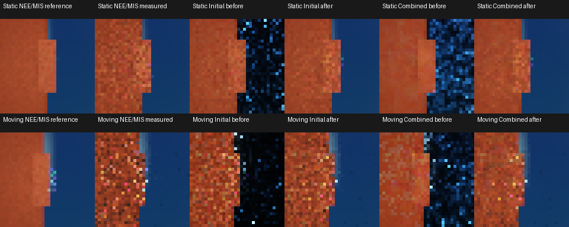

# ReSTIR complementary BSDF direct lighting

Measured 2026-10-16 on Windows, MSVC 19.51 Release, Vulkan/Slang,
NVIDIA RTX A5000. Source base: `f5bb962`, with the complementary reservoir/BSDF
partition and validation changes. Matched before measurements are the
[narrow-glossy report](2026-10-16-restir-glossy.md). The
[reservoir reference](../reference/RESTIR.md#emission-accounting) owns the
estimator and diagnostic contract.

## Change and independent checks

Previously, reservoirs estimated the entire table-backed primary direct-light
integral and transport suppressed its BSDF-found emission. The change retains
BSDF-found triangle emission, analytic crossings and environment-map lighting
with their existing NEE/MIS weights. Final reservoir RGB receives the
complementary light weight at the current receiver. This partitions the
integrand using the power-table NEE and BSDF densities, without assuming a
marginal PDF for a reservoir's selected sample. Targets, support correction,
normalization and diagnostic RGB retain the full integrand.

Sphere payloads retain whole-area points, but their partition uses the
power-selected cone density used by BSDF crossings. Other mappings already
reconstruct the matching NEE density. Delta lights retain weight one. Failed
or empty records return before dereferencing a light key; overflow rejection
and failure latching remain covered.

The GPU executable adds independent checks under both integrators and every
proposal/reuse mode:

- Two full-sphere distant lights with exact power probabilities 1/4 and 3/4
  provide closed-form Lambert weights. CPU reconstruction of the fresh BSDF
  direction and saved reservoir RGB predicts every rendered pixel. Initial
  mode uses one frame; reuse modes use three after a cut.
- Roughness-0.08 metal in a constant textured environment plus a full-sphere
  distant light and an unsampled constant environment is checked against
  double-precision GGX half-vector quadrature, independent of the shader's
  visible-normal sampler. Each case uses eight samples per pixel with 0.6%
  tolerance. Quadrature uses 65,536 inverse-NDF intervals at normal incidence;
  camera zoom 100 limits view-angle departure.

Existing independent light integrals, mixed proposals, Cornell multibounce
comparisons and reuse arithmetic/visibility tests remain. An added radius-1.5
sphere subtends a wider cone and checks its analytic irradiance, making the
sphere density distinction observable.

## Matched procedure

Four retained invocations run serially after physical-GPU tests finish: seeds
`17` and `262165` under each integrator. Settings match before: 32x32, 16
measured frames, four independent sequences, four warmup frames, 64 analytic
lights, candidates 1 and 8, history cap 32, radius 1, power proposals and one
bounce. Radiance reuse is disabled. The unchanged static and camera-only
moving fixtures retain roughness-0.08 metal, small rect/disk emitters, a fixed
foreground panel and a procedural HDR environment.

Each pose has the same two disjoint 512-spp NEE/MIS reference halves as before,
always rendered by the reference integrator. Their mean is a finite reference,
not an exact integral. Shared reference seeds across invocations/integrators
are not independent reference estimates. Measured sequences start with cuts
and disjoint RNG ranges.

```sh
build/cy2026-windows-x86_64-py313-core/adapters/headless/lotus-headless --benchmark-restir build/restir-bsdf-reference-0.json --benchmark-label "f5bb962 plus complementary reservoir/BSDF partition; Release; 2026-10-16" --benchmark-integrator reference --restir-workload glossy-disocclusion --benchmark-size 32 --benchmark-frames 16 --benchmark-warmup 4 --restir-sequences 4 --restir-lights 64 --restir-reference-samples 512 --restir-candidates 1,8 --restir-history-cap 32 --restir-seed 17
python scripts/restir_budget.py build/restir-bsdf-reference-0.json build/restir-bsdf-reference-1.json --rmse 0.2 0.1 0.05 --output build/restir-bsdf-reference-summary.json
```

Repeat with seed `262165` and suffix `-1.json`, then `wavefront` and distinct
paths. The [summary JSON](2026-10-16-restir-bsdf-partition.json) retains
build/device/settings, budgets, regional/temporal populations, memory, history
counts and GPU stage medians. Raw JSON/PFM/logs and independent consumer
`build/verify-restir-bsdf.py` remain under `build/`.

All four invocations pass with Vulkan/synchronization validation available
and zero captured messages. Both integrators have exactly equal quality,
temporal, memory and history populations in all 36 matched case pairs; all
106 matched PFM pairs are byte identical. These matched draws are not extra
independent trials. All 84 NEE/MIS/reference images are byte identical to
before; memory/history/surface counts are unchanged. Independently reducing
saved ensemble/reference PFMs reproduces all 72 regional RMS/signed-RGB
measurements within 2e-6 absolute/relative serialization tolerance.

## Quality

Tables use arithmetic means over the two invocations and eight-candidate
reservoir rows. Both integrators give the same values. Static prefix RMS is
each invocation's RMS over four independent 16-sample sequence averages;
right-band RMS uses its pooled 64-sample ensemble. The fixed right screen
band is not a material or disocclusion mask.

| Mode | Prefix RMS before | Prefix RMS after | Right band before | Right band after |
| --- | --- | --- | --- | --- |
| NEE/MIS | 0.178646 | 0.178646 | 0.000836 | 0.000836 |
| Initial | 0.817655 | 0.135127 | 0.709432 | 0.000704 |
| Temporal | 0.536712 | 0.146865 | 0.448402 | 0.000741 |
| Spatial | 0.458084 | 0.129476 | 0.307767 | 0.000689 |
| Spatiotemporal | 0.270549 | 0.131137 | 0.179416 | 0.001185 |

Moving fresh-frame RMS is averaged over all poses. Right-band ensembles use
four independent sequences at the final pose, without averaging different
poses into a static solution.

| Mode | Fresh RMS before | Fresh RMS after | Right band before | Right band after |
| --- | --- | --- | --- | --- |
| NEE/MIS | 0.724503 | 0.724503 | 0.002881 | 0.002881 |
| Initial | 1.824812 | 0.551496 | 2.735941 | 0.002761 |
| Temporal | 1.278388 | 0.528422 | 0.753146 | 0.002888 |
| Spatial | 1.161249 | 0.526029 | 1.368602 | 0.002741 |
| Spatiotemporal | 0.752875 | 0.519974 | 0.354563 | 0.003556 |

The reproduced narrow-glossy error is reduced within these fixtures. Static
combined-reuse lag-one residual correlation changes from 0.076551 to
-0.058730; moving changes from -0.037920 to -0.068715. Short sequences,
finite reference noise and motion limit interpretation; no effective sample
count or absence of temporal artifacts is established. Static reference-half
split RMS remains 0.043897; moving split RMS spans 0.043897–0.053045. These
finite results do not prove absence of bias.



The contact sheet uses the first reference-integrator invocation: finite
reference, measured NEE/MIS, and eight-candidate initial/combined ensembles
before and after. Top: pooled 64 static samples. Bottom: four final-pose
samples. Panels use `RGB / (1 + RGB)`, gamma 1/2.2 and nearest-neighbour
magnification. Linear PFMs retain the quantitative values.

## Cost and quality budgets

Scene GPU medians span these ranges over the two repetitions:

| Scene | Integrator | Combined before ms | Combined after ms | NEE/MIS after ms |
| --- | --- | --- | --- | --- |
| Static | reference | 0.599424–0.653664 | 0.992576–1.027552 | 0.099200–0.108192 |
| Moving | reference | 0.485920–0.607968 | 0.768960–0.885952 | 0.048192–0.048640 |
| Static | wavefront | 0.628768–0.799296 | 0.773248–1.211104 | 0.174624–0.190016 |
| Moving | wavefront | 0.672480–0.772544 | 0.931264–1.191776 | 0.088768–0.089024 |

Transport reconstructs the selected light again for the partition and restores
the existing analytic-light crossing loop on BSDF continuation. No new shadow
query or persistent resource is introduced. Scene time includes metadata and
reservoir passes, excluding uploads/readback. Dynamic clocks and validation
remain enabled; before/after timing is not an interleaved trial. The source
adds work, but these timings do not isolate each operation's cost.

All eight-candidate modes now reach static RMS 0.2 in both repetitions,
compared with no reservoir attainment before. NEE/MIS needs 16 samples;
eight-candidate modes need 16 and 8 respectively. At that quality, combined
reuse takes 20.719776/8.097544 ms versus NEE/MIS 1.796456/1.648856 ms under
reference, and 13.630688/15.377336 ms versus 3.163208/2.919720 ms under
wavefront. No equal-quality speedup is established. One-candidate temporal-only
still misses RMS 0.2 in both repetitions. No mode reaches 0.1 or 0.05 in this
horizon. Moving scenes have no static budget.

## Validation and scope

The managed core build and all 38 tests pass in 647.81 seconds, followed by
strict renderer-evidence validation. The runtime-free build/test has 25
passes and two explained GPU SKIPs. All 45 Python tests and documentation
validation pass. The managed Hydra build and all three targeted integration
checks pass: ReSTIR contract, moving-stage GPU and installed usdview host.
The host test takes 111.00 seconds; the group takes 119.08 seconds. The full
Hydra suite and release gate are not rerun for this shared-shader change.

```sh
ost build --jobs auto
ost test
ost validate --strict-renderer-evidence
ost build --without-runtime --intent ci-core --jobs auto
ost test --without-runtime --intent ci-core
ost build --profile lookdev --intent hydra --jobs auto
ctest --test-dir build/cy2026-windows-x86_64-py313-lookdev--hydra -C Release -R 'hydra-restir|usdview-host' --output-on-failure
python -m unittest discover -s scripts -p 'test_*.py'
python scripts/check_docs.py
```

This addresses the reproduced low-roughness gap within these fixtures in
LOTUS-RESTIR-05. Broader glossy/artifact/bias coverage, reuse cost, temporal
correlation, scope review and the release gate remain in the
[execution plan](../roadmap/current.md#execution-order).
