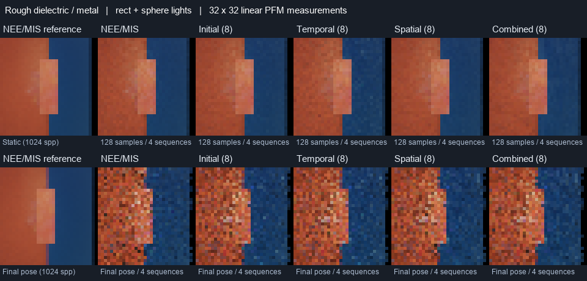

# ReSTIR rough dielectric and sphere-light comparison

Measured 2026-10-16 on Windows, MSVC 19.51 Release, Vulkan/Slang,
NVIDIA RTX A5000. Source base: `9595454`, plus the headless
`glossy-spheres` workload and regional measurements. The
[reservoir reference](../reference/RESTIR.md#headless-reservoir-comparison)
owns scene definitions and metric semantics. Transport shaders, reservoir
arithmetic and public renderer settings are unchanged.

## Procedure

The new static/moving pair combines roughness-0.18, IOR-1.5 red dielectric,
roughness-0.5 blue metal, alternating rect/sphere lights, a fixed foreground
panel and the procedural HDR environment. The metal slopes more steeply
than the narrow-glossy fixture. Only the camera moves; its first pose matches
the static control. This broadens material, roughness, receiver-normal and
light-mapping coverage. It is not a power-matched comparison with older scenes.

Four retained invocations run serially: seeds `17` and `262165` under each
integrator. Each uses 32x32, 32 measured frames, four independent sequences,
four warmup frames, 64 analytic lights, candidate counts 1 and 8, history cap
32, radius 1, power proposals and one scattering bounce. Radiance reuse is
disabled. Each measured sequence starts with a cut and a disjoint RNG range.
The fourth invocation resumes later the same day. No physical-GPU test or
other benchmark overlaps these runs. Runtime-free CPU build/checks overlap
part of the first invocation; wall times are not used for cost conclusions.

Each pose uses two disjoint 512-spp NEE/MIS reference halves, always rendered
by the reference integrator. Their mean is a finite reference, not an exact
integral. Reference seeds are shared across invocations/integrators; these
repeats do not provide independent reference estimates.

```sh
build/cy2026-windows-x86_64-py313-core/adapters/headless/lotus-headless --benchmark-restir build/restir-spheres-reference-0.json --benchmark-label "9595454 plus glossy sphere dielectric workloads; Release; 2026-10-16" --benchmark-integrator reference --restir-workload glossy-spheres --benchmark-size 32 --benchmark-frames 32 --benchmark-warmup 4 --restir-sequences 4 --restir-lights 64 --restir-reference-samples 512 --restir-candidates 1,8 --restir-history-cap 32 --restir-seed 17
python scripts/restir_budget.py build/restir-spheres-reference-0.json build/restir-spheres-reference-1.json --rmse 0.2 0.1 0.05 --output build/restir-spheres-reference-summary.json
```

Repeat with seed `262165` and suffix `-1.json`, then `wavefront` and distinct
paths. The [summary JSON](2026-10-16-restir-glossy-spheres.json) retains build,
device, settings, quality budgets, three regional/temporal populations,
per-invocation stage-time medians, memory and history counts. Raw JSON/PFM/logs
and independent consumer `build/verify-restir-spheres.py` remain under `build/`.

## Results

All four invocations pass with Vulkan and synchronization validation available
and zero captured messages. Both integrators have exactly equal quality,
temporal, memory and history populations in all 36 matched case pairs, and
all 138 matched PFM pairs are byte identical. These matched draws are not
extra independent trials. Static and moving first-pose reference images match
byte for byte. Independently reducing saved ensemble/reference PFMs reproduces
all 108 regional RMS/signed-RGB measurements within 2e-6 absolute/relative
serialization tolerance, as well as each ensemble's full-frame RMS.

Tables use arithmetic means over the two invocations and eight-candidate
reservoir rows; both integrators give the same quality values. Static prefix
RMS is each invocation's RMS across four independent 32-sample sequence means.
Regional RMS instead uses the pooled 128-sample ensemble. Lag-one is the mean
over eight finite-sequence residual correlations.

| Mode | Prefix RMS | Center RMS | Left dielectric RMS | Right metal RMS | Lag-one |
| --- | --- | --- | --- | --- | --- |
| NEE/MIS | 0.051874 | 0.036481 | 0.032927 | 0.003644 | -0.035275 |
| Initial | 0.050598 | 0.036328 | 0.033117 | 0.004218 | -0.031794 |
| Temporal | 0.074193 | 0.053350 | 0.047788 | 0.008102 | 0.074596 |
| Spatial | 0.050431 | 0.036728 | 0.032071 | 0.004015 | -0.032148 |
| Spatiotemporal | 0.059154 | 0.046392 | 0.035986 | 0.006297 | 0.012646 |

Moving fresh-frame RMS is averaged over all poses. Regional ensembles use
four independent sequences at the final pose; they do not average different
poses into a static solution. Regions are fixed screen bands, rather than
material/disocclusion masks, and can contain different surfaces during motion.

| Mode | Fresh RMS | Center RMS | Left dielectric RMS | Right metal RMS | Lag-one |
| --- | --- | --- | --- | --- | --- |
| NEE/MIS | 0.285233 | 0.199050 | 0.180644 | 0.019726 | -0.035522 |
| Initial | 0.276758 | 0.200028 | 0.177550 | 0.021483 | -0.031820 |
| Temporal | 0.275540 | 0.197791 | 0.180056 | 0.022523 | 0.044715 |
| Spatial | 0.275561 | 0.202528 | 0.173802 | 0.020947 | -0.029150 |
| Spatiotemporal | 0.275415 | 0.196849 | 0.171984 | 0.022025 | 0.010433 |

Temporal-only and combined reuse increase static prefix error relative to
initial-only and spatial-only, alongside positive measured residual
correlation. The moving fresh error improves slightly, but this does not
establish improved static convergence or absence of ghosting. Static reference
split RMS is 0.017667; moving split RMS spans 0.014620–0.020237. Short
sequences, finite references and two measured seeds do not distinguish bias
from rare-event variance or establish an effective independent sample count.



The first reference-integrator invocation supplies the contact sheet: finite
reference, NEE/MIS and eight-candidate reservoir ensembles. Top: pooled 128
static samples. Bottom: four final-pose samples. Panels use `RGB / (1 + RGB)`,
gamma 1/2.2 and nearest-neighbour magnification; linear PFM files retain the
quantitative values.

## Cost and quality budgets

Scene GPU medians span these ranges over the two repetitions:

| Scene | Integrator | NEE/MIS ms | Initial (8) ms | Combined (8) ms |
| --- | --- | --- | --- | --- |
| Static | reference | 0.101728–0.135424 | 0.390720–0.530208 | 0.583264–0.833440 |
| Moving | reference | 0.044928–0.127904 | 0.424192–0.471200 | 0.151904–0.152640 |
| Static | wavefront | 0.232288–0.234080 | 0.125248–0.764320 | 0.805568–0.950048 |
| Moving | wavefront | 0.083840–0.201184 | 0.523168–0.763680 | 0.197536–0.611072 |

Scene time includes metadata and reservoir passes, excluding uploads/readback.
Validation and dynamic clocks remain enabled. Runs are not interleaved and
the wide timing spread does not isolate individual operations' costs.
For combined reuse, reservoir and metadata device/host capacity is respectively
1,310,720 and 295,472 bytes at 32x32; total VRAM remains unavailable.

At static RMS 0.1, NEE/MIS, initial, spatial and combined modes require 16
samples in both repetitions; temporal-only requires 16 and 32. Reference
combined cumulative GPU times are 10.126496/16.546560 ms versus NEE/MIS
2.263240/1.627896 ms. Wavefront combined times are 17.331976/22.402976 ms
versus NEE/MIS 3.871464/3.755768 ms. Thus combined reuse establishes no
equal-quality speedup. Wavefront initial-only is faster at that quality in
one repetition and slower in the other (1.93x and 0.30x paired speedup).
No repeatable initial-only speedup is established either. Initial and spatial
reach RMS 0.05 in only one repetition; other eight-candidate modes and NEE/MIS
do not reach it in this horizon. Moving scenes have no static quality budget.

## Validation and scope

The managed core build and all 40 tests pass in 680.29 seconds, followed by
strict renderer-evidence validation with completion-bound producers. This
includes both integrators' workload/proposal checks, reservoir GPU arithmetic,
visibility/lifecycle/overflow, synchronization, reference images, missing-driver
handling and install-tree checks. The runtime-free build/test records 27
passes and two explained GPU SKIPs. All 45 Python tests
and documentation validation pass. The focused GPU checks for both new
benchmark configurations pass in 70.01 seconds, including finite-reference
labels, static convergence/moving semantics, three regions, history acceptance,
memory, saved images, CLI rejection and first-pose reference equality.

```sh
ost build --jobs auto
ost test
ost validate --strict-renderer-evidence
ost build --without-runtime --intent ci-core --jobs auto
ost test --without-runtime --intent ci-core
python -m unittest discover -s scripts -p 'test_*.py'
python scripts/check_docs.py
```

Hydra and its release gate are not rerun for this headless benchmark change.
This is bounded one-bounce coverage within LOTUS-RESTIR-05.
Production materials/multibounce coverage, broader bias and
artifact assessment, reuse cost, temporal correlation, scope review and the
release gate remain in the [execution plan](../archive/pre-v070-execution-plan.md#execution-order).
