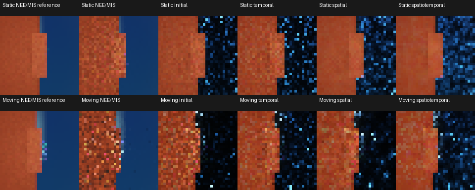

# ReSTIR narrow-glossy camera disocclusion

Measured 2026-10-16 on Windows, MSVC 19.51 Release, Vulkan/Slang,
NVIDIA RTX A5000. Source base: `656da5e`; the measured build adds the headless
`glossy-disocclusion` workload and regional measurements. Transport shaders,
reservoir arithmetic and public renderer settings are unchanged. The
[reservoir reference](../reference/RESTIR.md#headless-reservoir-comparison)
owns scene definitions and measurement semantics.

## Procedure

The new static and moving scenes combine roughness-0.08 metal, red Lambert
surfaces, small rect/disk emitters and a procedural HDR environment. Area-light
power matches the mixed-boundary fixture while emitter dimensions shrink by
five. A fixed foreground panel is present in both scenes. The moving scene
changes only camera translation/yaw, exposing parallax, disocclusion and
view-dependent glossy contributions. Its first pose matches the static camera.

Four retained invocations run serially after physical-GPU tests finish: two
independent measured seeds per integrator, `17` and `262165`. Each uses 32x32,
16 measured frames per sequence, four sequences, four warmup frames, 64
analytic lights, candidates 1 and 8, history cap 32, radius 1, power proposals
and one scattering bounce. Radiance reuse is disabled. No physical-GPU test
or benchmark overlaps these retained measurements.

Each pose has two disjoint 512-spp NEE/MIS reference halves, always using the
reference integrator. Their mean is the saved finite reference. Reference
seeds are shared across invocations/integrators; their repeated values are
not independent reference estimates. Every measured sequence starts with a
history cut and uses the comparison's disjoint measured RNG ranges.

```sh
build/cy2026-windows-x86_64-py313-core/adapters/headless/lotus-headless --benchmark-restir build/restir-glossy-reference-0.json --benchmark-label "656da5e plus glossy disocclusion workloads; Release; 2026-10-16" --benchmark-integrator reference --restir-workload glossy-disocclusion --benchmark-size 32 --benchmark-frames 16 --benchmark-warmup 4 --restir-sequences 4 --restir-lights 64 --restir-reference-samples 512 --restir-candidates 1,8 --restir-history-cap 32 --restir-seed 17
python scripts/restir_budget.py build/restir-glossy-reference-0.json build/restir-glossy-reference-1.json --rmse 0.2 0.1 0.05 --output build/restir-glossy-reference-summary.json
```

Repeat with seed `262165` and suffix `-1.json`, then run the group with
`wavefront` and distinct paths. The
[summary JSON](2026-10-16-restir-glossy.json) retains settings, build/device
identity, quality populations, budgets, temporal residuals, both regions,
per-invocation stage-time medians, memory and history counts. Raw JSON/PFM/logs
and independent consumer `build/verify-restir-glossy.py` remain under `build/`.

## Results

All four retained invocations pass with Vulkan and synchronization validation
available and zero captured messages. Both integrators produce exactly equal
quality, temporal, memory and history populations in all 36 matched case
pairs. All 106 matched PFM pairs are byte identical. These matched draws are
not additional independent trials. Static and moving first-pose reference
images also match byte for byte. Independently reducing saved ensemble and
reference PFMs reproduces all 72 regional RMS/signed-RGB measurements within
float serialization tolerances of 2e-6 absolute/relative.

Static reference-half split RMS is 0.043897; moving split RMS ranges from
0.043897 to 0.053045. Neither scene claims an exact integral.

The static table uses arithmetic means over the two invocations. Prefix RMS
is each invocation's RMS over four independent 16-sample sequence averages;
right-band RMS uses each invocation's pooled 64-sample ensemble. Lag-one is
the mean of eight finite-sequence residual correlations. Reservoir rows use
eight initial candidates. Both integrators give the same values.

| Mode | 16-sample prefix RMS | Right-band ensemble RMS | Lag-one |
| --- | --- | --- | --- |
| NEE/MIS | 0.178646 | 0.000836 | -0.065476 |
| Initial | 0.817655 | 0.709432 | -0.031213 |
| Temporal | 0.536712 | 0.448402 | 0.176149 |
| Spatial | 0.458084 | 0.307767 | -0.065177 |
| Spatiotemporal | 0.270549 | 0.179416 | 0.076551 |

The moving table instead reports mean fresh-frame RMS over all poses and a
four-sequence ensemble at the final pose for right-band RMS. It does not
average different poses as a static convergence solution. The right band is
a fixed screen region, not a disocclusion or material mask.

| Mode | Fresh frame RMS | Right-band ensemble RMS | Lag-one |
| --- | --- | --- | --- |
| NEE/MIS | 0.724503 | 0.002881 | -0.067096 |
| Initial | 1.824812 | 2.735941 | -0.062594 |
| Temporal | 1.278388 | 0.753146 | -0.053589 |
| Spatial | 1.161249 | 1.368602 | -0.064756 |
| Spatiotemporal | 0.752875 | 0.354563 | -0.037920 |

In this short static horizon, NEE/MIS reaches RMS 0.2 in both repetitions;
none of the reservoir modes at either candidate count reaches that budget.
No mode reaches 0.1 or 0.05. Combined reuse reduces the measured reservoir
error, but still leaves visible noise and larger glossy-region error than
NEE/MIS. One-candidate initial-only final-prefix RMS varies from 0.579831 to
3.752350 across the two repetitions, showing why a single seed is insufficient
for this fixture. These finite measurements do not distinguish rare-event
variance from systematic bias.



The contact sheet uses the first reference-integrator invocation: finite
NEE/MIS reference, measured NEE/MIS and eight-candidate reservoir ensembles.
The top row pools 64 static samples; the bottom row pools four final-pose
samples. All panels use `RGB / (1 + RGB)`, gamma 1/2.2 and nearest-neighbour
magnification. The original linear PFM images retain the quantitative values.

Scene-duration medians span these ranges across the two repetitions:

| Workload | Integrator | NEE/MIS GPU ms | Combined GPU ms |
| --- | --- | --- | --- |
| Static | reference | 0.055712–0.099328 | 0.599424–0.653664 |
| Moving | reference | 0.049024–0.049216 | 0.485920–0.607968 |
| Static | wavefront | 0.191776–0.196640 | 0.628768–0.799296 |
| Moving | wavefront | 0.088544–0.088896 | 0.672480–0.772544 |

Scene time includes metadata and reservoir passes, excluding uploads/readback.
Dynamic clocks and validation remain enabled. No reservoir equal-quality
speedup is established because those modes do not attain the measured static
budget. Moving scenes have no static quality budgets. GPU time and finite
sample error must be considered together.

## Validation and scope

The managed core build and all 38 tests pass in 567.70 seconds, followed by
strict renderer-evidence validation with completion-bound producers. This
includes both new glossy benchmark checks, both integrators' existing
workloads/proposals, reservoir GPU arithmetic/visibility/lifecycle coverage,
synchronization, reference images, missing-driver handling and install-tree
checks. The runtime-free build/test has 25 passes and two explained GPU SKIPs.
All 45 Python tests and documentation validation pass.

```sh
ost build --jobs auto
ost test
ost validate --strict-renderer-evidence
ost build --without-runtime --intent ci-core --jobs auto
ost test --without-runtime --intent ci-core
python -m unittest discover -s scripts -p 'test_*.py'
python scripts/check_docs.py
```

Hydra and its release gate are not rerun for this headless workload change.
This adds bounded artifact/convergence evidence to LOTUS-RESTIR-05. The
low-roughness convergence gap, broader bias/artifact coverage, reuse cost,
temporal correlation, scope review and release gate remain in the
[execution plan](../archive/pre-v070-execution-plan.md#execution-order).
