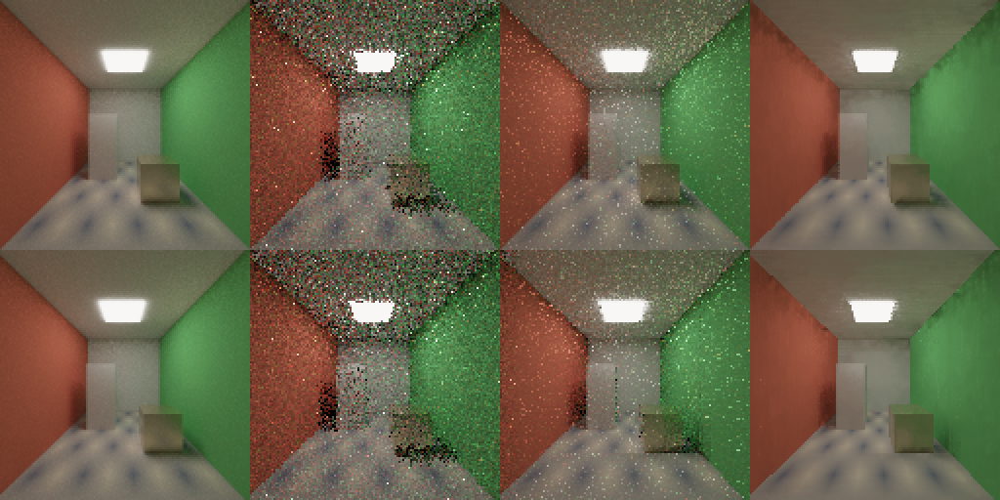

# SVGF edge-aware filtering and reference comparison

Measured 2026-10-18 on Windows 11, MSVC 14.51 Release, Vulkan SDK 1.3.290
with the Khronos validation layer, NVIDIA RTX A5000 (driver 597.16), clocks
not locked. Source base: main `be7df4d` plus the LOTUS-SVGF-02 change. The
[temporal reference](../reference/TEMPORAL.md#edge-aware-filtering) owns the
contract; the [roadmap](../roadmap/README.md#status-at-a-glance) owns phase
status.

## Question

[LOTUS-SVGF-02](../roadmap/current.md#step-3--svgf-core) completes the
headless [SVGF-class baseline](../design/ROADMAP_POLICY.md#renderer-phase-6--denoising--svgf-class-pipeline):
edge-aware a-trous filtering guided by depth, normals, motion, stable
identity and luminance variance, and the final composite. Raw low-spp
radiance, temporal accumulation alone and the filtered output are compared
with a high-spp reference on RMS/MSE, temporal residual, disocclusion
response, static convergence and moving-camera stability, under both
integrators, with deterministic validation.

## What changed

- **Surface inputs.** The primary-surface pass now also writes the
  material's base colour (unorm8) and the shading normal (octahedral
  snorm16) into two of `TemporalPixel`'s reserved words, as `albedo` and
  `shading_normal`. The record stays 64 bytes.
- **Illumination moments.** The accumulation's moments are now of the
  colour demodulated by that albedo, so texture contrast does not count as
  noise. The colour history itself is unchanged.
- **Filter.** `TemporalFrameSettings::filter_iterations` (0 to 8, default
  off) runs SVGF's a-trous filter over the accumulated radiance after the
  variance pass: a 5x5 B3-spline footprint with taps `2^i` pixels apart,
  limited to the same placement and weighted by shading normal, linear depth
  against the local depth gradient and illumination luminance against four
  standard deviations of the 3x3-filtered variance; the composite
  remodulates by the albedo into the colour attachment. Each iteration is a
  fullscreen pass over a 32-byte-per-pixel ping-pong buffer; `filter_gpu_ms`
  times them in a ten-query temporal pool.
- **Decisions.** The history is not fed back from the filter, and the
  luminance test uses the variance of the accumulated mean (`variance / b`)
  rather than SVGF's per-sample variance; the
  [contract](../reference/TEMPORAL.md#edge-aware-filtering) lists the
  differences from SVGF. Changing the iteration count never resets history.
- **Oracle and campaign.** `FilterTemporalRadiance` in `temporal.hpp` is the
  CPU oracle. `lotus-headless --benchmark-svgf` is the comparison campaign;
  the `research` tier runs a small version of it under both integrators.

## Checks

`lotus-renderer-temporal` (fast tier) adds the packing round trips,
demodulation with a zero albedo channel, and filter cases with closed-form
results: uniform illumination under a checker albedo is unchanged at every
iteration count, misses and other placements are neither changed nor used,
a single bright pixel under very large variance keeps exactly
`(3/8)^2` of its excess, zero variance keeps noise-free detail, and depth
and normal steps stop the filter however large the variance.

`lotus-renderer-temporal-gpu` (gpu tier) cycles the filter through off, five
iterations, off and one iteration across its radiance sequence (static,
cap saturation, camera and object motion, every reset reason, failed calls,
disocclusion), without resetting the history:

| Check, per integrator | Result |
| --- | --- |
| Filtered frames compared with the CPU oracle at every pixel | 38 |
| Maximum relative error of the composite | 1.2e-5 |
| Unfiltered frames: colour attachment equals the temporal mean | every pixel |
| Illumination moments against independent batches | max relative error 6.0e-7 |
| Variance against the CPU oracle | max absolute error 9.3e-5 |
| Albedo product on the static plane | exactly the base colour's unorm8 |
| Shading normal product (no authored normals) | geometric normal within 2e-4 |
| Too many iterations, filter without radiance | fail without consuming history |
| Validation messages | none |

The variance error grew from 4.35e-6 because illumination values are the
colour divided by an albedo of 0.2 to 0.6; it is relative to the same
tolerance.

## Comparison

**Workload.** A closed room (`svgf-room`) lit only by an emissive ceiling
panel, so most light is indirect: red, green and white Lambert walls, a
floor whose base colour is an 8x8 checker texture, a white box and a rough
(0.3) metal block. The static variant holds the camera; the moving variant
pans the camera and slides the block over a full cycle, exposing floor and
wall behind it with rigid placement motion only, so history is never reset
globally.

**Procedure.** 128x128, 32 frames, one fresh sample per frame (the
viewport's case), history cap 32, five iterations, four bounces, NEE/MIS.
Eight independent sequences per workload, each from a camera cut with a
disjoint sample range. Every pose has a reference from the reference
integrator: two disjoint halves of 1024 samples, whose mean is the
reference and whose difference estimates its noise (MSE 0.00017, two orders
below the smallest error reported). One render per frame supplies all three
outputs: the fresh batch (raw), the bounded temporal mean (temporal) and
the composite (filtered), since the filter never feeds back into history.

```sh
build/cy2026-windows-x86_64-py313-core/adapters/headless/lotus-headless --benchmark-svgf build/svgf-campaign/svgf-reference.json --benchmark-label "main be7df4d plus LOTUS-SVGF-02; Release; 2026-10-18" --benchmark-integrator reference --benchmark-size 128 --benchmark-frames 32 --svgf-sequences 8 --svgf-reference-samples 1024
```

The same with `wavefront`. Each run took 33–37 s. The
[summary JSON](2026-10-18-svgf-filter.json) keeps the procedure, the device,
every per-frame series and the observed timings; raw JSON, PFMs and the
reducer remain under `build/svgf-campaign/`.

**Both integrators produced identical outputs**, value for value: they
draw the same samples, and nothing after the fresh batch depends on the
integrator. Each workload's first sequence, rendered again from a new cut,
reproduced every raw, temporal and filtered value bit for bit under both.



*Last frame of the first sequence, tone-mapped: reference, raw (one
sample), temporal mean and filtered. Static above, moving below.*

### Static convergence

| Output | Mean MSE, 32 frames | First frame | Last frame | Frame-delta MSE | Last-frame squared bias |
| --- | --- | --- | --- | --- | --- |
| Raw | 0.356 | 0.363 | 0.371 | 0.709 | ≈ 0 (-0.002) |
| Temporal | 0.0460 | 0.363 | 0.0113 | 0.0109 | ≈ 0 (-0.0003) |
| Filtered | **0.0305** | **0.0882** | 0.0181 | **0.00084** | 0.0158 |

The filter cuts the first frame's error by a factor of 4.1 and flicker
(the frame-to-frame change of the error) by 13 against the temporal mean.
From the fourteenth frame on, the temporal mean is the more accurate: its
error keeps falling with the samples while the filtered error approaches
its own bias, squared about 0.016 by the eight-sequence ensemble, against a
sampling noise of 0.0003 left in it. The bias is blur: the luminance test
admits differences up to four standard deviations of the accumulated mean,
and one-sample path tracing in this room is noisy enough (raw MSE 0.36) that
even 32 samples leave that window wide enough to spread fireflies into the
low-frequency blotches visible on the walls, and to soften gradients. The
textured floor keeps its pattern, as demodulation intends.

### Moving camera and disocclusion

| Output | Mean MSE, 32 frames | Last frame | Frame-delta MSE | Last-frame squared bias |
| --- | --- | --- | --- | --- |
| Raw | 0.354 | 0.348 | 0.709 | 0.004 |
| Temporal | 0.0798 | 0.0390 | 0.126 | 0.005 |
| Filtered | **0.0391** | **0.0295** | **0.0471** | 0.028 |

Under motion the filter halves the mean error and is ahead at every frame;
the temporal mean never accumulates enough history to overtake it, because
motion keeps rejecting and the cap bounds the rest. Flicker falls by 2.7.

By the history length of each pixel, frames after the cut pooled:

| MSE by history (batches) | 1 | 2–3 | 4–7 | 8+ |
| --- | --- | --- | --- | --- |
| Pixels | 218,800 | 496,728 | 750,288 | 2,597,416 |
| Raw | 0.350 | 0.333 | 0.319 | 0.368 |
| Temporal | 0.350 | 0.157 | 0.0672 | 0.0317 |
| Filtered | **0.129** | **0.0653** | **0.0355** | **0.0250** |

A pixel whose history was just rejected (one batch) is where the temporal
mean helps not at all and the filter most, by a factor of 2.7: the boosted
spatial variance makes the luminance test widest there. The advantage
narrows with history; in the static view, with longer histories, it reverses
at eight batches and more (0.0241 against 0.0212).

## Cost

Observed with the validation layer and dynamic clocks, medians per frame at
128x128: filter 0.88–1.16 ms for five iterations, accumulation 0.07 ms,
variance 0.03–0.19 ms. At 512x512 without the layer the filter took 4.7 ms
in the static view and 54 ms in the moving one, where every pass was about
ten times slower (the primary-surface pass 1.1 ms instead of 0.2 ms): the
moving workload's scene updates leave the GPU idle between frames, and
its clocks fall (P8, 210 MHz, was observed at rest). These are not costs.
Each tap reads from a 64-byte surface record and a 32-byte radiance record
besides its 16-byte filter value, so the filter is bound by memory traffic;
packing its guides into a compact buffer is the obvious reduction. Viewport-resolution timing belongs to
[LOTUS-SVGF-03](../roadmap/current.md#step-4--svgf-in-the-viewport), with
denoise timing in the HUD.

## After the comparison

- **For the viewport (LOTUS-SVGF-03).** Filtering is worth having whenever
  the view or the scene moves and in the first frames after a change; on a
  view held still, the temporal mean overtakes it within about fourteen
  frames at one sample per frame. The run-time toggle is therefore not only
  a debug switch.
- **After the baseline.** The residual bias and blotches are what the
  [phase rule](../design/ROADMAP_POLICY.md#renderer-phase-6--denoising--svgf-class-pipeline)
  defers until the baseline is complete: firefly suppression and
  feature-adaptive filtering, for example fading the filter as a history
  converges. SVGF's history feedback would trade the opposite way, lower
  noise for accumulated bias, and is not adopted.

## Regression

Run after the change, in the core configuration: the `fast` and `gpu`
tiers, and in the `research` configuration the two new
`lotus-renderer-svgf-benchmark-*` tests and `lotus-test-tiers`. Not rerun:
the rest of the `research` tier (the ReSTIR campaign code is unchanged), the
Hydra configuration (the adapter reads only `sample_count` of the radiance
records and does not set the filter), the runtime-free `ci-core`
configuration and the viewport builds, whose settings default the filter
off.

## Limits

- One workload, one resolution, one sample per frame. Its conclusions are
  about this baseline in a room dominated by noisy indirect light, not about
  SVGF in general.
- Demodulation divides by the base colour, so glossy reflection and
  emission are filtered as if they were diffuse illumination.
- Silhouettes use the pixel-centre surface while the radiance is jittered
  within the pixel, so edge pixels mix two surfaces' light.
- No Hydra control or AOV for the filter yet; viewport controls and views
  come with LOTUS-SVGF-03.
