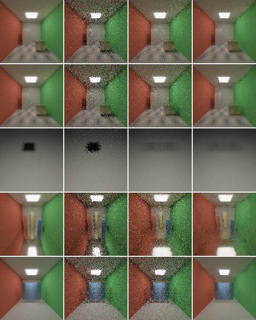

# Interactive quality: fixed fixtures and baseline

Measured 2026-11-08 on Windows 11, MSVC 14.51 Release, Vulkan 1.4.329 with
validation layers disabled through the loader, NVIDIA RTX A5000 (driver
597.16), clocks not locked. Source base: main `9643900` plus the
LOTUS-INTERACTIVE-02 change. The
[interactive-quality contract](../design/INTERACTIVE_QUALITY.md) owns the
presets and metrics; the
[temporal reference](../reference/TEMPORAL.md#headless-svgf-comparison) owns
the benchmark; the [roadmap](../roadmap/README.md#status-at-a-glance) owns
phase status.

## Question

LOTUS-INTERACTIVE-02 adds the contract's
[fixed fixture set](../design/INTERACTIVE_QUALITY.md#7-measuring-still-and-moving-separately)
and records today's behaviour on it, with no renderer change, before any
preset or fix exists. The baseline answers the contract's questions for
`main`: how the still image converges, how stable and how lagged the moving
image is, how pixels respond after disocclusion, and what it costs. Later
tasks are held to these numbers.

## What changed

- `lotus-headless --benchmark-svgf` runs five workloads instead of two. The
  `svgf-room` pair is unchanged; three scenes are new (below).
- Each workload names a lag region, and every output reports its MSE there,
  per frame and pooled after the cut (`lag_region_mse`).
- Resets after a sequence's cut are counted by reason
  (`history_resets_after_cut`) instead of failing the run, since the deforming
  workload resets on every frame today.
- A fourth output, `progressive`, renders the same frames through
  `RenderScene`, one batch per frame as the hosts draw it: the image the
  Reference preset shows. It restarts at the sequence's sample index on every
  change. The benchmark requires the sample count it reports, which confirms
  that it restarted on every frame of the four moving workloads and
  accumulated in the still one.
- The report schema is `lotus-svgf-benchmark-v2`; its CTests
  (`lotus-renderer-svgf-benchmark-*`, research tier) check every workload,
  lag region and output.

No code outside the headless benchmark and its test changed, so the
renderer is untouched. The `svgf-room` results below match the
[SVGF comparison](2026-10-18-svgf-filter.md#comparison) to every reported
digit.

## Fixtures

| Workload | Contract fixture | Scene | Lag region |
| --- | --- | --- | --- |
| `svgf-room-static-v1` | `svgf-room`, static | The SVGF comparison's closed room, held still | None |
| `svgf-room-moving-camera-block-v1` | `svgf-room`, moving | The camera pans and the metal block slides | None |
| `occluder-shadow-sweep-v1` | Occluder over a still receiver | A camera three units up looks 60° down at a floor. A 0.5-unit emissive panel above and behind it lights the floor through an occluder that slides ±0.9 in X just above the camera, out of view, sweeping a shadow about 2.2 times its size | Swept pixels: the reference luminance ranges over more than a tenth of its brightest pose and six times the mean reference noise (about 2,100 pixels) |
| `glossy-floor-camera-pan-v1` | Camera over a low-roughness surface | The room's shell with a roughness-0.1 metal floor and three coloured posts; the camera, tilted 17° down, pans ±0.6 | The metal floor's pixels, by their primary albedo (about 4,900) |
| `deforming-sheet-v1` | Deforming mesh | The room's shell with a still camera facing a 32x16-quad sheet whose wave travels across it; topology fixed | The sheet's pixels (about 1,300) |

In the shadow workload every visible surface is still, so primary validity
accepts every pixel and any change is lighting. Each moving workload runs one
cycle over its frames.

## Procedure

As the SVGF comparison: 128x128, one fresh sample per frame, history cap 32,
five filter iterations, four bounces, NEE/MIS, eight sequences per workload
from a camera cut with disjoint sample ranges, every pose referenced by two
disjoint 1024-sample halves of the reference integrator. Two runs per
integrator: 32 frames per cycle, as before, and 128 frames per cycle, which
shows the still view past the history cap and the moving workloads at a
quarter of the speed.

```sh
lotus-headless --benchmark-svgf build/interactive-baseline/interactive-baseline-reference.json --benchmark-label "main 9643900 plus LOTUS-INTERACTIVE-02; Release; 2026-11-08; dynamic clocks; validation layers disabled" --benchmark-integrator reference --benchmark-size 128 --benchmark-frames 32 --svgf-sequences 8 --svgf-reference-samples 1024
```

The same with `wavefront`, and with `--benchmark-frames 128`, run serially
with `VK_LOADER_LAYERS_DISABLE=VK_LAYER_KHRONOS_validation`. Runs took 49–51 s
at 32 frames and 201–202 s at 128. The
[summary JSON](2026-11-08-interactive-baseline.json) keeps the procedures,
the device and every scene's statistics, with per-frame series for the
32-frame run and the 128-frame still view; raw reports, PFMs and clock logs
remain under `build/interactive-baseline/`.

**Both integrators produced identical outputs** in every workload of both
runs, and every first sequence rendered again from a new cut reproduced its
raw, temporal and filtered values bit for bit.



*Last frame of the first 32-frame sequence, tone-mapped: reference, raw (one
sample), temporal mean and filtered. From the top: still room, moving room,
shadow sweep, glossy pan, deforming sheet. The shadow's trail in the
temporal and filtered images is the lag this set exists to expose.*

## Still: convergence

`svgf-room-static-v1`, MSE against the reference:

| Output | Mean, 32 frames | Last of 32 | Mean, 128 frames | Last of 128 | Last-frame squared bias, 128 |
| --- | --- | --- | --- | --- | --- |
| Raw | 0.356 | 0.371 | 0.355 | 0.337 | ≈ 0 |
| Temporal (cap 32) | 0.0460 | 0.0113 | 0.0166 | 0.00611 | ≈ 0 (0.00007) |
| Filtered | **0.0305** | 0.0181 | 0.0209 | 0.0174 | 0.0163 |
| Progressive (Reference) | 0.0460 | 0.0113 | **0.0155** | **0.00297** | ≈ 0 |

Up to the cap the temporal mean and the progressive render hold the same
samples and agree to four digits (they differ only in summation order).
Beyond it the temporal mean becomes an exponential average with weight
1/32, whose noise settles near that of 63 samples: 0.0061 against
Reference's 0.0030 at 128 samples, and the gap keeps growing with the
sample target. The filtered image stops improving at its bias, squared
0.016, which it reaches by about frame 14 as the SVGF comparison found.
Neither output today converges to the still image; that is the gap
Balanced's [settling](../design/INTERACTIVE_QUALITY.md#4-settling) has to
close.

## Moving: stability, lag and disocclusion

32 frames per cycle. Frame-delta MSE is the frame-to-frame change of the
error; the lag column is the MSE in the workload's lag region; the bias
column is the last frame's squared error of the eight sequences' mean less
its expected noise.

| Workload | Output | Mean MSE | Frame-delta MSE | Lag-region MSE | Last-frame squared bias |
| --- | --- | --- | --- | --- | --- |
| Moving room | Raw | 0.354 | 0.709 | – | ≈ 0 |
| | Temporal | 0.0798 | 0.126 | – | 0.005 |
| | Filtered | **0.0391** | **0.0471** | – | 0.028 |
| | Progressive (Reference) | 0.348 | 0.213 | – | ≈ 0 |
| Shadow sweep | Raw | 2.45e-4 | 4.90e-4 | **6.67e-4** | ≈ 0 |
| | Temporal | 1.80e-4 | 3.37e-5 | 1.27e-3 | 1.69e-4 |
| | Filtered | **1.50e-4** | **2.69e-5** | 1.20e-3 | 1.66e-4 |
| | Progressive (Reference) | 2.45e-4 | 7.29e-5 | 6.77e-4 | ≈ 0 |
| Glossy pan | Raw | 1.24 | 2.48 | **1.93** | ≈ 0 |
| | Temporal | 1.04 | 0.447 | 3.03 | 0.68 |
| | Filtered | **0.872** | **0.155** | 2.84 | 0.70 |
| | Progressive (Reference) | 1.25 | 0.580 | 1.95 | ≈ 0 |
| Deforming sheet | Raw, temporal, progressive | 0.363 | 0.0103 | 0.0594 | ≈ 0 |
| | Filtered | **0.0885** | **0.00059** | **0.00291** | 0.085 |

**Shadow and reflection lag.** In both lag regions the temporal mean is
worse than a single fresh sample: by 1.9 times in the shadow's sweep and 1.6
in the metal floor, although the whole image improves. Its error there is
bias, not noise (the bias column against a sampling noise of 1e-6 and
0.013), so the history is accurate for a surface that is wrong about its
lighting, as the contract's
[§6](../design/INTERACTIVE_QUALITY.md#6-what-per-pixel-history-may-get-wrong)
predicts. The filter does not remove it (1.20e-3 and 2.84). At a quarter of
the speed (128 frames per cycle) the ratios fall to 1.3 and 1.2
(8.70e-4 against 6.70e-4, and 2.34 against 1.93), since the history has less
lighting change to trail. The longest histories carry the most error: in
both workloads the 8+ bucket is the temporal mean's worst (glossy 1.37
against 0.40 for 2–3 batches). These lag-region MSEs are what
LOTUS-INTERACTIVE-05's candidates must lower.

**Deformation.** All 248 frames after the cut (1,016 at 128 frames) reset
with `scene-changed`, so the temporal mean never holds more than the fresh
batch, and because a reset restarts at `sample_index`
([DES-Q7](../design/DESIGN_POLICY.md#53-open-questions)) its image is bit for
bit the progressive render's. The filter is the only reduction (MSE 4.1
times lower) and its error is almost all bias. This is the baseline for the
contract's deformation row, which LOTUS-INTERACTIVE-03 changes to per-pixel
history.

**Frozen noise.** The same restart repeats each pixel's random numbers on
every changed frame. Raw frame-delta MSE on the sheet is 0.0103 where
independent samples would give about 0.73 (twice the MSE), and Reference's
frame-delta MSE is 0.213 in the moving room and 0.580 on the glossy floor
against raw's 0.709 and 2.48. Under motion Reference therefore shows a noise
pattern standing still rather than flickering, and its frame-delta MSE
understates its noise. Frame-delta comparisons between Reference and the
history presets have to state this, as DES-Q7 already requires.

**Disocclusion.** In the moving room, by history length after the cut:
one-batch pixels 0.350 raw, 0.350 temporal, 0.129 filtered; 8+ batches
0.368, 0.0317, 0.0250, as in the SVGF comparison. The glossy pan's
one-batch pixels are 0.486 raw and 0.091 filtered.

## Cost

Medians per frame at 128x128, reference integrator, 32-frame run:
primary surface 0.033 ms, reprojection 0.006 ms, accumulation 0.006 ms,
variance 0.005–0.037 ms, filter 0.078–0.079 ms for five iterations. History
buffers take 2,621,440 bytes (160 per pixel) and the filter 786,432 (48 per
pixel) in every workload. The 128-frame runs timed every pass two to six
times slower, and their once-a-second clock log puts 15–21% of the samples
in P5 or P3 at 375–1200 MHz, against P0 at 1695–1920 MHz otherwise. These
are observations, not costs: the contract asks for
[locked clocks](../reference/RESTIR.md#campaigns), which need an
administrator. A candidate's cost under LOTUS-INTERACTIVE-05 has to be
measured that way, against this procedure at locked clocks.

## For the following tasks

- **LOTUS-INTERACTIVE-03.** The deforming sheet should keep history outside
  the sheet and lose its `scene-changed` resets; Reference has to stay the
  progressive render measured here.
- **LOTUS-INTERACTIVE-04.** Settling has to beat the cap's plateau (0.0061
  at 128 frames) and reach Reference's 0.0030. The set has no workload that
  stops moving, which §4's no-pop requirement measures; holding the last
  pose of the moving workloads for a number of frames is a procedure change
  for that task, not a new fixture.
- **LOTUS-INTERACTIVE-05.** The lag metric has a target in two fixtures,
  shadow (1.27e-3) and reflection (3.03), each above a single sample's error;
  the deforming sheet's lag cannot be measured until 03 gives it history.

## Regression

Run after the change, in the `research` configuration: both
`lotus-renderer-svgf-benchmark-*` tests and `lotus-test-tiers`; and
`scripts/check_docs.py`. Not rerun: the core, Hydra,
runtime-free and viewport configurations, which do not build or run the
headless benchmark's changed code.

## Limits

- One resolution and one sample per frame. Each moving workload is one
  synthetic motion at two speeds, chosen to expose one effect each; their
  ratios are not predictions for other scenes.
- The swept region is found from the references and so includes the
  shadow's penumbra over its whole path, also on frames where it is not
  there.
- The albedo regions use the unjittered pixel centre's surface, so silhouette
  pixels of another surface can fall in or out of them.
- The timings were taken at dynamic clocks and are not cost evidence.
